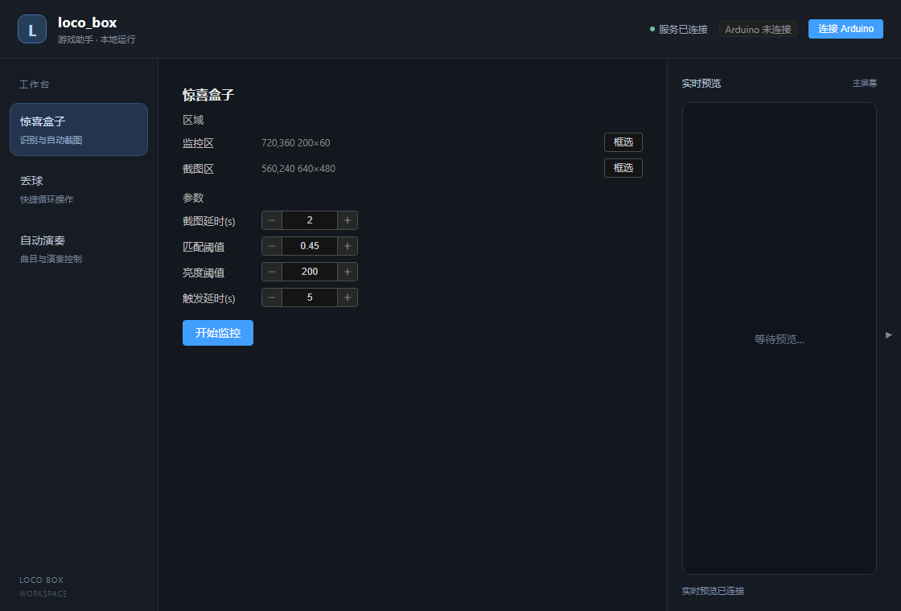
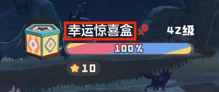
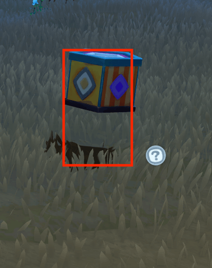

# Loco Box · 本地游戏自动化工具箱

Windows 桌面应用，包含惊喜盒子监控、循环丢球、自动演奏和精灵查看。Vue 负责配置界面，Tauri 负责桌面和悬浮窗，Python 负责截图识别、自动化与精灵数据解析。游戏输入统一通过 Arduino USB HID 发送；精灵查看独立读取本机流量，无需 Arduino。

## 硬件要求

- **Arduino ATmega32U4**（Pro Micro / BadUSB / Leonardo 兼容板），USB-C 或 Micro-USB
- 固件：`scripts/arduino_bridge/arduino_bridge.ino`（Arduino IDE 上传，选 Arduino Leonardo）

精灵查看无需 Arduino。实时监听需要 [Npcap](https://npcap.com/#download) 和配套协议资源，示例回放只需导入资源。准备方法见 [精灵查看说明](docs/PET_VIEWER.md)。

## 快速启动

环境已配置好后，双击仓库根目录的 **`start.bat`**。

- 首次启动会构建桌面程序，Rust 首次编译可能需要数分钟，并显示构建进度。
- 后续启动直接运行已有程序，不启动 Vite、Node 或 Cargo。前端或桌面源码变化时才重新构建；后端改动随下次启动加载。
- 后端启动期间会显示连接状态，就绪后自动出现功能面板；连接中断也会自动恢复。
- 重复双击会激活已打开的窗口。关闭主窗口会退出悬浮窗并释放应用自己启动的后端。

当前构建是**在本仓库内运行的桌面版本**，需要保留 `.venv`、`backend/` 和 `loco_box/`。历史 Releases 的单文件程序属于旧 Tkinter 版本，不能代表当前 Vue/Tauri 功能；当前尚未提供内置 Python 的独立安装包。

## 惊喜盒子上手

1. Arduino 插上 USB
2. 双击运行 `start.bat`

   

3. 点击**监控区域**，框选包含「幸运惊喜盒」五个白字的区域

   

4. 点击**截图区域**，框选盒子打完以后要截图的区域

   

5. 调整参数：
   - **延迟**：文字消失后等待多久再截图（默认 1 秒）
   - **阈值**：匹配灵敏度（默认 0.45）
   - **亮度**：白色笔画提取阈值（默认 200）
   - **按键**：检测到盒子后多久发送按键 1（默认 5 秒）
   - **COM**：Arduino 端口（默认 AUTO 自动检测）

6. 点击**开始**启动监控

7. 检测到盒子后按设定延时发送按键 1；文字消失后截图并显示在预览区

## 当前版本说明

当前代码为 **Vue3 + FastAPI + Tauri 2** 多窗口架构（本地 Web 前端 + 本地后端 + 系统级悬浮窗），含惊喜盒子、丢球、自动演奏、精灵查看四个功能。开发者文档见 [docs/](docs/README.md)。

## 精灵查看

打开“精灵查看”，选择自动或指定网卡，先开始监听，再登录进入游戏世界并遭遇野生精灵。面板和独立悬浮窗显示原始性格、属性增减及已下发的声音、体型、血脉、异色信息；真实遭遇保存在本机历史。该功能只接受野生交互 PVE，战斗属性修正不会覆盖原始性格。

首次使用需导入 `all.pb` 和 `gamedata.json`，随后可点击「示例回放」检查解析与显示。合成示例不写入真实遭遇历史。资源获取、导入命令和实时监听步骤见 [精灵查看说明](docs/PET_VIEWER.md)。

## MIDI 与和弦演奏

自动演奏可以直接导入 `.mid` / `.midi`，支持多音轨、变速和同时按下多个键。打开「自动演奏」，导入文件、选择音轨，检查九音手碟的音域与重击冲突后播放；原有 TXT 歌单仍可使用。

目标键位是 `B/F/G/H/J/K/T/Y/U`，每个起音触发 50ms 短按。默认与原转谱脚本共用自动识调和音级折叠，将所有音高映射到九键；密集重击、同键映射和超容量和弦自动分次或顺延演奏，保留全部音符。点击播放会自动保存设置。

v2 固件支持同时演奏九键和弦，另有六键兼容编译模式；旧固件也可直接演奏 MIDI，和弦自动按单键顺序敲出。详见 [演奏使用与设计](docs/MUSIC.md) 和 [固件协议/编译](docs/PROTOCOL.md)。

## 从源码运行

首次准备需要 Windows、Python 3.9、Node.js LTS、Rust 和 Visual Studio C++ 构建工具。已完成构建且源码未变时，日常运行不需要启动 Node/Rust 工具链。

```powershell
py -3.9 -m venv .venv
.\.venv\Scripts\python.exe -m pip install -r requirements.txt
# 前端依赖不存在时，启动器会执行 npm ci
.\start.bat

# 显式开发模式，带热更新与可见日志
.\start.bat dev
# 只构建，不打开窗口
.\start.bat build
# 检查解释器、依赖、构建产物与服务状态
.\start.bat doctor

# 或分开跑（开发调试用，两个终端）：
.\.venv\Scripts\python.exe -m uvicorn backend.main:app --host 127.0.0.1 --port 8790
cd frontend
npm ci
npm run dev
```

MIDI 直接演奏使用运行依赖中的 Mido，不需要先转谱。本地手碟模拟器是可选工具，需要额外安装 `.venv\Scripts\python.exe -m pip install -r requirements-tools.txt`。日常应用不再依赖旧界面库 customtkinter。

运行数据在 `data/`：配置 `settings.json`、模板 `template.png`、旧歌单 `scores/`、MIDI 原文件及逐曲设置 `music/`、精灵资源及历史 `pet_viewer/`。启动日志在 `data/logs/backend.log`，构建日志在 `data/logs/build.log`。排查启动问题先运行 `start.bat doctor`，再查看界面连接详情及日志。

串口诊断统一使用 `.venv\Scripts\python.exe scripts/diagnose_arduino.py --list` 列出设备。需要实测按键时，先关闭应用或手动断开 Arduino，再运行 `--music` 测试九音键，或用 `--keys 1 Y --hold-ms 50 100 200` 比较按住时长；默认自动检测端口，也可用 `--port COM端口号` 指定。工具用一次连接完成测试，发送前预留 5 秒切换窗口。更多可选工具说明见 [scripts/README.txt](scripts/README.txt)。

## 验证改动

```powershell
.\.venv\Scripts\python.exe -m unittest discover -s tests -v
cd frontend
npm ci
npm run build
npx playwright install chromium
npm test
cd src-tauri
cargo test --locked --lib
```

前端测试覆盖启动与重连、曲库与演奏控制、精灵查看及悬浮窗初始化。后端回归使用模拟设备和合成报文，无需 Arduino、Npcap 或游戏资源。

## 文档

| 文档 | 内容 |
|------|------|
| [CLAUDE.md](CLAUDE.md) | AI Agent 协作规则与硬约束 |
| [docs/README.md](docs/README.md) | 开发者文档索引 |
| [docs/TECH-STACK.md](docs/TECH-STACK.md) | 技术栈与版本 |
| [docs/ARCHITECTURE.md](docs/ARCHITECTURE.md) | 架构（进程/窗口/数据流/线程） |
| [docs/FEATURES.md](docs/FEATURES.md) | 功能详解 + 扩展指南 |
| [docs/API.md](docs/API.md) | 后端 API 参考 |
| [docs/PET_VIEWER.md](docs/PET_VIEWER.md) | 精灵查看、资源导入与实战验证 |
| [docs/PROTOCOL.md](docs/PROTOCOL.md) | Arduino 串口协议 |
| [docs/CHANGELOG.md](docs/CHANGELOG.md) | 更新记录 |
