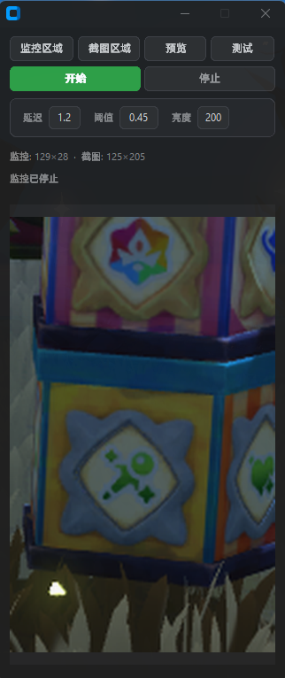

# 洛克王国 S2 幸运惊喜盒监控

自动检测游戏中「幸运惊喜盒」文字，出现后自动按键 1 交互，消失后截图保存。

## 硬件要求

- **Arduino ATmega32U4**（Pro Micro / BadUSB / Leonardo 兼容板），USB-C 或 Micro-USB
- 淘宝搜 "BadUSB ATmega32U4 USB-C"，¥10 以内
- 固件：`scripts/arduino_bridge.ino`（Arduino IDE 上传，选 Arduino Leonardo）

## 下载

在 [Releases](https://github.com/cheng1608/loco_box/releases) 页面下载 `loco_box.exe`。

## 首次启动

1. Arduino 插上 USB
2. 双击运行 `loco_box.exe`

   

3. 点击**监控区域**，框选包含「幸运惊喜盒」五个白字的区域

   

4. 点击**截图区域**，框选盒子打完以后要截图的区域

   

5. 调整参数：
   - **延迟**：文字消失后等待多久再截图（默认 1 秒）
   - **阈值**：匹配灵敏度（默认 0.45）
   - **亮度**：白色笔画提取阈值（默认 200）
   - **按键**：检测到盒子后多久发送按键 1（默认 5 秒）
   - **COM**：Arduino 端口（默认 AUTO 自动检测）

6. 点击**开始**启动监控

7. 文字消失后自动截图显示在预览区，同时 Arduino 发送按键 1

## 从源码运行

```bash
pip install -r requirements.txt
python main.py
```

## 文档

| 文档 | 内容 |
|------|------|
| [CLAUDE.md](CLAUDE.md) | AI Agent 开发参考 |
| [docs/ARCHITECTURE.md](docs/ARCHITECTURE.md) | 项目架构 |
| [docs/PROTOCOL.md](docs/PROTOCOL.md) | Arduino 串口协议 |
| [docs/API.md](docs/API.md) | 模块接口参考 |
